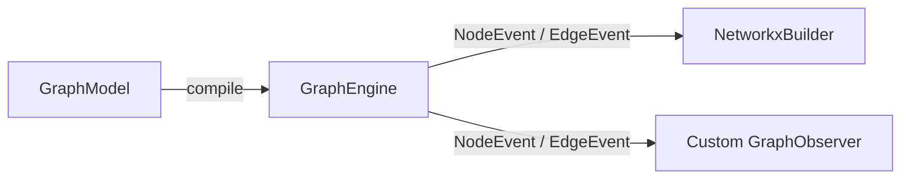

# The Graph Engine

Graphinate decouples **graph traversal and event generation** (`GraphEngine`) from **graph storage and representation** (`GraphObserver` implementations such as `NetworkxBuilder`).

## Architecture Overview

When a `GraphModel` is executed, `GraphEngine`:

1. Compiles an immutable, validated copy of the `GraphModel`.
2. Notifies all subscribed observers via `on_start(name)`.
3. Traverses root and hierarchical `@model.node` generators, resolving `ParentId` dependencies and lineage tuples, and emits `NodeEvent` (and hierarchical `EdgeEvent`) instances.
4. Evaluates `@model.edge` generators and emits `EdgeEvent` instances.
5. Notifies all subscribed observers via `on_finish()`.



## Subscribing Custom Observers

You can implement the `GraphObserver` protocol to stream graph generation events to logs, progress bars, databases, or message queues without waiting for an in-memory graph to finish building:

```python
from graphinate import EdgeEvent, GraphEngine, GraphObserver, NodeEvent, model

my_model = model(name="Pipeline")

@my_model.node()
def service():
    yield "auth-api"
    yield "billing-api"


class AuditObserver:
    def on_start(self, name: str) -> None:
        print(f"Starting model: {name}")

    def on_node(self, event: NodeEvent) -> None:
        print(f"Node: {event.node_id} (type={event.type}, lineage={event.lineage})")

    def on_edge(self, event: EdgeEvent) -> None:
        print(f"Edge: {event.source_id} -> {event.target_id}")

    def on_finish(self) -> None:
        print("Execution complete.")


engine = GraphEngine(my_model)
engine.subscribe(AuditObserver())
engine.run()
```

## Event Contracts

* **`NodeEvent`**: Immutable dataclass carrying `node_id`, `type`, `label`, `value`, `magnitude`, `lineage`, `multiplicity`, and `created`.
* **`EdgeEvent`**: Immutable dataclass carrying `source_id`, `target_id`, `type`, `label`, `value`, `weight`, `is_hierarchy`, and `created`.

## Asynchronous Execution (`async def`)

`@model.node` and `@model.edge` support asynchronous generator functions (`async def ... yield`) as well as coroutine functions (`async def ... return [...]`). You can mix synchronous and asynchronous generators freely within the same `GraphModel` and execute them with `await engine.arun(...)` or `await builder.abuild(...)` (or `await graphinate.abuild(BuilderCls, model)`):

```python
import asyncio
from graphinate import abuild, model
from graphinate.builders import NetworkxBuilder

async_model = model(name="Async Pipeline")

@async_model.node()
async def repository():
    await asyncio.sleep(0.01)
    yield "graphinate"

async def main():
    graph = await abuild(NetworkxBuilder, async_model)
    print(graph.nodes)
```

!!! tip "Performance & Benchmarks"
    In pure in-memory scenarios, synchronous builds achieve the lowest overhead by avoiding coroutine frame
    allocation. In I/O-bound pipelines (fetching from microservices, APIs, or databases), asynchronous builds with
    `abuild()` enable concurrent execution via `asyncio.gather()`, achieving multi-fold speedups.
    See [Performance Optimization](optimization.md#synchronous-vs-asynchronous-execution-performance) for benchmarks.

